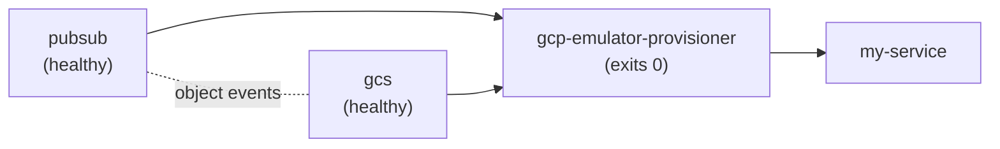

# Add the GCP emulators to your Compose project

After this your own Docker Compose stack starts the Pub/Sub emulator and fake-gcs-server, runs
the provisioner against them, and starts your applications only once every topic,
subscription and bucket exists.

## When you need this

Your services use Google Cloud Pub/Sub or Cloud Storage, and you want `docker compose up` to
give every developer the same local copies, already populated, without a Google Cloud
project. You do not want to copy image tags, arguments and healthchecks out of this
repository and keep them in sync by hand.

## What you need to know first

- **The emulator fragment.** [`docker-compose.emulators.yaml`](../../docker-compose.emulators.yaml)
  holds only the two emulator services, `pubsub` and `gcs`, with pinned images, arguments and
  healthchecks. The provisioner and your applications stay in your own file. See
  [Reusing the emulator stack](../../README.md#reusing-the-emulator-stack).
- **Compose `include:`.** A top-level `include:` (Docker Compose v2.20 or later) pulls another
  Compose file into your project as if its services were declared in yours. It accepts local
  paths only, so you keep a copy of the fragment in your repository. See
  [Use include](https://docs.docker.com/compose/how-tos/multiple-compose-files/include/).
- **Start order.** `depends_on` with `condition: service_healthy` waits for a container's
  healthcheck to pass; `condition: service_completed_successfully` waits for a container to
  exit with code `0`. The provisioner is a one-shot container that exits `0` when provisioning
  succeeded and `1` when it failed ([Exit Codes](../../README.md#exit-codes)).
- **The emulators keep nothing.** The Pub/Sub emulator holds topics and subscriptions in
  memory, and the fragment starts fake-gcs-server on its in-memory backend. Every fresh `up`
  starts empty, and the provisioner creates everything again.

This is the start order you are building:



## Steps

### 1. Copy the fragment into your project

Copy [`docker-compose.emulators.yaml`](../../docker-compose.emulators.yaml) from this
repository into your project unchanged, for example as `gcp/docker-compose.emulators.yaml`,
or vendor the repository as a submodule or subtree. Leave the copy unedited: everything you
normally change is an environment variable with a default (step 5), so the next update
replaces the file without merging local edits.

### 2. Write the provisioner config

Create `gcp-config.yaml` next to your Compose file with the resources your services expect.
This example declares the topic that fake-gcs-server publishes object events to (see
[Receive Cloud Storage notifications locally](receive-bucket-notifications-locally.md)), one
subscription and one bucket:

```yaml
project_id: local-dev

pubsub:
  topics:
    - name: storage-notifications
      subscriptions:
        - name: storage-notifications-local
          ack_deadline: 30s

storage:
  buckets:
    - name: uploads
```

[`config.example.yaml`](../../config.example.yaml) shows every field.

### 3. Include the fragment and add the provisioner

In your `compose.yaml`, include the fragment and add the provisioner, waiting for both
emulators to be healthy. `PUBSUB_EMULATOR_HOST` and `STORAGE_EMULATOR_HOST` are the variables
the Google client libraries already read; they point at the in-network addresses `pubsub:8085`
and `gcs:4443`, which the fragment fixes whatever host ports you publish.

```yaml
include:
  - path: gcp/docker-compose.emulators.yaml

services:
  gcp-emulator-provisioner:
    image: ghcr.io/datarocks-ag/gcp-emulator-provisioner:latest
    depends_on:
      pubsub: { condition: service_healthy }
      gcs:    { condition: service_healthy }
    environment:
      GCP_PROJECT_ID: local-dev
      PUBSUB_EMULATOR_HOST: pubsub:8085
      STORAGE_EMULATOR_HOST: gcs:4443
    volumes:
      - ./gcp-config.yaml:/config.yaml:ro
```

The image reads `./config.yaml` by default, which inside the container is `/config.yaml`; set
`GCP_CONFIG_PATH` if you mount it elsewhere.

### 4. Make your applications wait for the provisioner

Add `service_completed_successfully` to every service that needs the resources, and give it
the same two variables. If provisioning fails, Compose does not start the application, so it
never runs against a half-populated emulator.

```yaml
  my-service:
    image: <your-image>
    depends_on:
      gcp-emulator-provisioner: { condition: service_completed_successfully }
    environment:
      PUBSUB_EMULATOR_HOST: pubsub:8085
      STORAGE_EMULATOR_HOST: gcs:4443
```

A Java Virtual Machine (JVM) application that needs a service account key file and a token endpoint as well is
covered in [Give a JVM application credentials for the emulators](give-a-jvm-app-credentials-for-the-emulators.md).

### 5. Change the defaults you need to

The fragment reads these variables when Compose interpolates the file, so set them in the
shell or in a `.env` file next to your `compose.yaml`, not in a service's `environment:`
block:

| Variable | Default | Sets |
|---|---|---|
| `GCP_PROJECT_ID` | `local-dev` | the emulator project, the project object events are published to, and the storage healthcheck query |
| `PUBSUB_EMULATOR_PORT` | `8085` | the published host port of `pubsub` |
| `STORAGE_EMULATOR_PORT` | `4443` | the published host port of `gcs` |
| `STORAGE_EMULATOR_PUBLIC_HOST` | `localhost:4443` | the `Host` that path-style signed URLs must be requested with |
| `STORAGE_NOTIFICATIONS_TOPIC` | `storage-notifications` | the topic object events are published to |
| `STORAGE_NOTIFICATIONS_EVENTS` | `finalize` | a comma-separated list of object events to publish |

For example, a `.env` that moves both emulators off their default host ports:

```dotenv
PUBSUB_EMULATOR_PORT=18085
STORAGE_EMULATOR_PORT=14443
STORAGE_EMULATOR_PUBLIC_HOST=localhost:14443
```

Change `STORAGE_EMULATOR_PUBLIC_HOST` together with `STORAGE_EMULATOR_PORT`: fake-gcs-server
only serves a path-style signed URL when the request's `Host` matches it. Containers keep
using `pubsub:8085` and `gcs:4443` either way.

## Check that it works

Start the stack:

```console
$ docker compose up -d
…
 Container <project>-pubsub-1 Healthy
 Container <project>-gcs-1 Healthy
 Container <project>-gcp-emulator-provisioner-1 Starting
 Container <project>-gcp-emulator-provisioner-1 Started
 Container <project>-gcp-emulator-provisioner-1 Waiting
 Container <project>-gcp-emulator-provisioner-1 Exited
 Container <project>-my-service-1 Starting
 Container <project>-my-service-1 Started
```

`docker compose ps -a` shows the provisioner `Exited (0)` and both emulators healthy and bound
to `127.0.0.1` only. This output was captured with `PUBSUB_EMULATOR_PORT=20085` and
`STORAGE_EMULATOR_PORT=20043`, and with a stand-in container listening on 8099 as
`my-service`; with the defaults you see `127.0.0.1:8085->8085/tcp` and
`127.0.0.1:4443->4443/tcp`:

```console
$ docker compose ps -a --format 'table {{.Service}}\t{{.Status}}\t{{.Ports}}'
SERVICE                    STATUS                    PORTS
gcp-emulator-provisioner   Exited (0) 1 second ago
gcs                        Up 7 seconds (healthy)    127.0.0.1:20043->4443/tcp
my-service                 Up Less than a second     8099/tcp
pubsub                     Up 7 seconds (healthy)    127.0.0.1:20085->8085/tcp
```

The provisioner log lists every resource it created (`time` fields trimmed):

```console
$ docker compose logs --no-log-prefix gcp-emulator-provisioner
{"time":"…","level":"INFO","msg":"Starting gcp-emulator-provisioner","version":"…"}
{"time":"…","level":"INFO","msg":"Loading configuration","path":"./config.yaml"}
{"time":"…","level":"INFO","msg":"Configuration loaded","section":"all","project":"local-dev","topics":1,"buckets":1,"credentials":0}
{"time":"…","level":"INFO","msg":"Connecting to Pub/Sub","project":"local-dev","emulator_host":"pubsub:8085"}
{"time":"…","level":"INFO","msg":"Connected to Pub/Sub","project":"local-dev","emulator":true}
{"time":"…","level":"INFO","msg":"Connecting to Cloud Storage","project":"local-dev","emulator_host":"gcs:4443"}
{"time":"…","level":"INFO","msg":"Connected to Cloud Storage","project":"local-dev","emulator":true}
{"time":"…","level":"INFO","msg":"Starting provisioning"}
{"time":"…","level":"INFO","msg":"Provisioning Pub/Sub","topics":1,"subscriptions":1}
{"time":"…","level":"INFO","msg":"Creating topic","topic":"storage-notifications"}
{"time":"…","level":"INFO","msg":"Creating subscription","subscription":"storage-notifications-local","topic":"storage-notifications"}
{"time":"…","level":"INFO","msg":"Provisioning Cloud Storage","buckets":1}
{"time":"…","level":"INFO","msg":"Creating bucket","bucket":"uploads"}
{"time":"…","level":"INFO","msg":"Provisioning complete"}
{"time":"…","level":"INFO","msg":"gcp-emulator-provisioner finished successfully"}
```

From the host, both emulators answer on the loopback ports. The Pub/Sub emulator also speaks
a REST (JSON over HTTP) API, so `curl` can list the topics (`<pubsub-port>` is
`PUBSUB_EMULATOR_PORT`, `8085` by default):

```console
$ curl -s http://localhost:<pubsub-port>/v1/projects/local-dev/topics
{
  "topics": [{
    "name": "projects/local-dev/topics/storage-notifications"
  }]
}
```

## Pitfalls

- **The first `up` takes minutes.** The Pub/Sub emulator image is roughly a gigabyte, so the
  first pull dominates a cold start. The fragment's healthcheck allows a 30-second
  `start_period` and 40 retries 5 seconds apart for that reason; do not shorten them.
- **A restarted `pubsub` comes back empty, and the provisioner does not rerun by itself.** If
  only the emulator container restarts, your applications get `NotFound` for every topic.
  Run the provisioner again with `docker compose run --rm gcp-emulator-provisioner`. After a
  `docker compose down` and `up` it runs again automatically. Objects in `gcs` are lost the
  same way; [Keep fake-gcs-server objects across restarts](keep-objects-across-restarts.md)
  shows how to keep them.
- **`localhost` inside a container is the container itself.** Your applications must use
  `pubsub:8085` and `gcs:4443`; the published ports are for tools on your host.
- **Other machines cannot reach the emulators.** Both ports are bound to `127.0.0.1`
  deliberately, because neither emulator enforces authentication. Exposing them to your
  network means editing the fragment, which loses the clean-update property of step 1.
- **The project id must match on both sides.** `GCP_PROJECT_ID` in `.env` configures the
  emulators; `GCP_PROJECT_ID` in the provisioner's `environment:` decides where resources are
  created. When the two differ, fake-gcs-server publishes object events to a project with no
  such topic and drops them.
- **`include:` has no URL form.** Pointing it at a raw GitHub URL fails; it needs a file on
  disk.
- **The provisioner fails and the app never starts.** Read the provisioner log: the `error`
  field of the `Provisioning failed` line names the resource. A connection problem shows up as
  retries for up to five minutes before the run fails.

## Further reading

- [Reusing the emulator stack](../../README.md#reusing-the-emulator-stack) in the README.
- [`docker-compose.emulators.yaml`](../../docker-compose.emulators.yaml) and its comments, and
  [`docker-compose.yaml`](../../docker-compose.yaml), the worked example this repository runs.
- [Emulator Caveats](../../README.md#emulator-caveats) for what the emulators do differently
  from Google Cloud.
- [Run one section per container](run-one-section-per-container.md) if your emulators live in
  different stacks.
- Docker documentation: [Use include](https://docs.docker.com/compose/how-tos/multiple-compose-files/include/)
  and [Control startup order](https://docs.docker.com/compose/how-tos/startup-order/).
