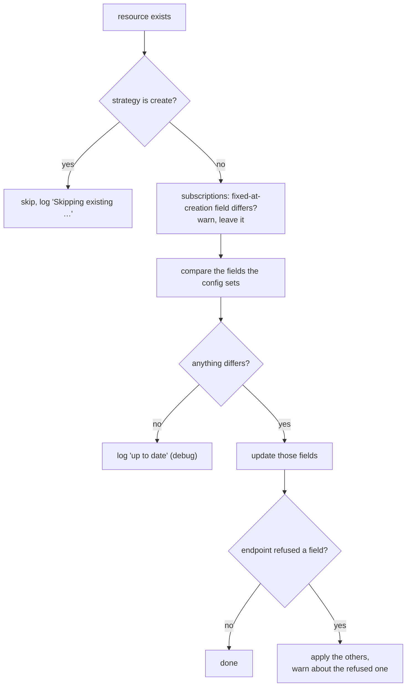

# Change settings on existing resources

After this you can change a setting on a topic, subscription or bucket that already exists, know
in advance whether the provisioner will apply it, and confirm that the next run has nothing left
to do.

## When you need this

Your stack is already provisioned and a consumer needs something different: a longer ack
deadline, more delivery attempts before a message goes to the dead letter topic, versioning on a
bucket. You change the config and run the provisioner again. This guide explains what that run
does with each kind of change — which ones it applies, which ones it only reports, and which ones
it leaves alone on purpose.

## What you need to know first

- **Strategy.** `update` creates a missing resource and brings an existing one in line with the
  config; `create` creates a missing resource and otherwise leaves it untouched. A topic,
  subscription or bucket uses its own `strategy` if set, otherwise the top-level `strategy`,
  otherwise `update`. A subscription does not inherit from its topic. Key files under
  `credentials` are the exception: they ignore the top-level strategy and default to `create`.
  See [Configuration](../../README.md#configuration).
- **Subset diffing.** Only fields the config sets are compared with the live resource. A field
  you leave out is never drift and is never reset. See
  [Reconciling one resource](../ARCHITECTURE.md#reconciling-one-resource).
- **Update mask.** Pub/Sub changes a resource through an update call that names the fields to
  change, the *update mask*. The provisioner sends only the drifted fields, and logs them under
  `fields`.
- **Tri-state booleans.** `retain_acked_messages`, `enable_message_ordering`,
  `enable_exactly_once_delivery` and a bucket's `versioning` have three states: omitted (leave
  the live value alone), `true` and `false` (both actively applied). See
  [Tri-state fields](../../README.md#tri-state-fields).
- **Two kinds of change that only warn.** Some subscription fields are fixed when Pub/Sub
  creates the subscription. Separately, the Pub/Sub emulator refuses a few updates that Google
  Cloud accepts. Both end in a warning instead of a failed run. See
  [Immutable Fields](../../README.md#immutable-fields) and
  [Emulator Caveats](../../README.md#emulator-caveats).
- **Nothing is ever deleted.** Removing a resource or a field from the config leaves it as it is
  in Pub/Sub or Cloud Storage.

This is how a run decides what to do with one existing resource:



## Steps

The examples start from a stack provisioned with this config:

```yaml
project_id: local-dev

pubsub:
  topics:
    - name: orders
      message_retention: 24h
      subscriptions:
        - name: order-processor
          ack_deadline: 30s
          dead_letter:
            topic: orders-dlq
            max_delivery_attempts: 5
    - name: orders-dlq

storage:
  buckets:
    - name: documents
```

### 1. Change the values in the config

Edit the values in place and add any setting you want the provisioner to manage from now on.
This version changes three values, starts managing `retain_acked_messages`, and turns on bucket
versioning:

```yaml
project_id: local-dev

pubsub:
  topics:
    - name: orders
      message_retention: 48h            # was 24h
      subscriptions:
        - name: order-processor
          ack_deadline: 60s             # was 30s
          retain_acked_messages: true   # new setting
          dead_letter:
            topic: orders-dlq
            max_delivery_attempts: 10   # was 5
    - name: orders-dlq

storage:
  buckets:
    - name: documents
      versioning: true                  # was omitted
```

Write every value of a block that the emulator would otherwise fill in. A `dead_letter` without
`max_delivery_attempts`, or a `retry` with only one of `minimum_backoff` and `maximum_backoff`,
never matches the live value, and every run updates it again.

To see the plan before applying it, run with `--dry-run` first, as described in
[Preview changes with dry-run](preview-changes-with-dry-run.md).

### 2. Run the provisioner

Run it the same way as for the first provisioning. Output captured against the emulators
(`google-cloud-cli:593.0.0-emulators` and `fake-gcs-server:1.56.1`) on 2026-11-15; the `time`
field is removed, and lines before `Provisioning Pub/Sub` are trimmed:

```json
…
{"level":"INFO","msg":"Provisioning Pub/Sub","topics":2,"subscriptions":1}
{"level":"INFO","msg":"Updating topic","topic":"orders","fields":["message_retention_duration"]}
{"level":"INFO","msg":"Updating subscription","subscription":"order-processor","fields":["ack_deadline_seconds","retain_acked_messages","dead_letter_policy"]}
{"level":"INFO","msg":"Provisioning Cloud Storage","buckets":1}
{"level":"INFO","msg":"Setting bucket versioning","bucket":"documents","enabled":true}
{"level":"INFO","msg":"Provisioning complete"}
{"level":"INFO","msg":"gcp-emulator-provisioner finished successfully"}
```

`orders-dlq` has no line: it matched the config, and an unchanged resource is logged only at
debug level. The `fields` list is the update mask, in Pub/Sub API names.

### 3. Run it again to confirm nothing is left to do

A second run with the same config should change nothing. Set `LOG_LEVEL=debug` to see each
resource reported as current (connection lines trimmed):

```json
…
{"level":"DEBUG","msg":"No credentials configured, skipping section"}
{"level":"INFO","msg":"Provisioning Pub/Sub","topics":2,"subscriptions":1}
{"level":"DEBUG","msg":"Topic up to date","topic":"orders"}
{"level":"DEBUG","msg":"Topic up to date","topic":"orders-dlq"}
{"level":"DEBUG","msg":"Subscription up to date","subscription":"order-processor"}
{"level":"INFO","msg":"Provisioning Cloud Storage","buckets":1}
{"level":"DEBUG","msg":"Bucket already exists","bucket":"documents"}
{"level":"DEBUG","msg":"Bucket versioning up to date","bucket":"documents","enabled":true}
{"level":"INFO","msg":"Provisioning complete"}
{"level":"INFO","msg":"gcp-emulator-provisioner finished successfully"}
```

If a resource shows `Updating …` again on this second run, its change does not converge; see
[Pitfalls](#pitfalls).

### 4. Recognise changes that are only reported

Two kinds of change end in a `WARN` line and a successful run, with the rest of the update still
applied. This config adds a `filter` and a label to the existing subscription and raises its ack
deadline once more:

```yaml
project_id: local-dev

pubsub:
  topics:
    - name: orders
      message_retention: 48h
      subscriptions:
        - name: order-processor
          ack_deadline: 90s             # was 60s
          retain_acked_messages: true
          filter: 'attributes.type = "order.created"'   # set after creation
          labels:
            team: checkout              # new label
          dead_letter:
            topic: orders-dlq
            max_delivery_attempts: 10
    - name: orders-dlq
```

Run with `--section=pubsub` against the emulator (connection lines trimmed):

```json
…
{"level":"INFO","msg":"Provisioning Pub/Sub","topics":2,"subscriptions":1}
{"level":"WARN","msg":"Subscription field cannot be changed after creation, leaving it as is","subscription":"order-processor","field":"filter","current":"","configured":"attributes.type = \"order.created\"","remedy":"delete the subscription by hand if the new value is required"}
{"level":"INFO","msg":"Updating subscription","subscription":"order-processor","fields":["ack_deadline_seconds","labels"]}
{"level":"WARN","msg":"Subscription field not supported by this Pub/Sub endpoint, leaving it unchanged","subscription":"order-processor","field":"labels","error":"updating subscription \"order-processor\" (labels): rpc error: code = InvalidArgument desc = Invalid update_mask provided in the UpdateSubscriptionRequest: labels is not a known Subscription field. Note that field paths must be of the form 'push_config' rather than 'pushConfig'."}
{"level":"INFO","msg":"gcp-emulator-provisioner finished successfully"}
```

- **`cannot be changed after creation`** — a fixed-at-creation field. `filter`,
  `enable_message_ordering` and the topic a subscription belongs to are fixed when Pub/Sub creates
  the subscription, on Google Cloud as in the emulator. The provisioner never sends them in an
  update; changing them means deleting the subscription by hand, which discards its backlog, and
  letting the next run create it again. The warning repeats on every run until the config and the
  subscription agree.
- **`not supported by this Pub/Sub endpoint`** — an emulator gap. The Pub/Sub emulator refuses
  to update `labels` on topics and subscriptions and `expiration_policy` on subscriptions, which
  Google Cloud accepts. The provisioner applies the other fields — the ack deadline above is now
  90 seconds — and warns about the refused one. Against the emulator this warning repeats on every
  run; against Google Cloud the label is applied. All three are accepted when the resource is
  *created*, so a new topic or subscription gets its labels even in the emulator.

### 5. Use `create` to freeze a resource

To stop the provisioner from touching resources that already exist, set `strategy: create` —
on the resource, or at the top level for everything. A resource's own strategy wins, so you can
freeze everything and still manage one subscription:

```yaml
project_id: local-dev
strategy: create                        # global: leave existing resources alone

pubsub:
  topics:
    - name: orders
      message_retention: 72h            # ignored: inherits create
      subscriptions:
        - name: order-processor
          strategy: update              # this one is still reconciled
          ack_deadline: 120s
    - name: orders-dlq

storage:
  buckets:
    - name: documents
      versioning: false                 # ignored: inherits create
```

```json
…
{"level":"INFO","msg":"Provisioning Pub/Sub","topics":2,"subscriptions":1}
{"level":"INFO","msg":"Skipping existing topic (strategy=create)","topic":"orders"}
{"level":"INFO","msg":"Skipping existing topic (strategy=create)","topic":"orders-dlq"}
{"level":"INFO","msg":"Updating subscription","subscription":"order-processor","fields":["ack_deadline_seconds"]}
{"level":"INFO","msg":"Provisioning Cloud Storage","buckets":1}
{"level":"INFO","msg":"Skipping existing bucket and its settings (strategy=create)","bucket":"documents"}
{"level":"INFO","msg":"Provisioning complete"}
{"level":"INFO","msg":"gcp-emulator-provisioner finished successfully"}
```

This config also drops `dead_letter` and `retain_acked_messages` from the subscription. Neither
is reset: an omitted field is left as it is, which the check below confirms.

## Check that it works

Read the live subscription from the Pub/Sub emulator's REST interface, on the same port as the
gRPC endpoint. After step 5 it carries the new ack deadline and still has the settings the last
config no longer mentions:

```console
$ curl -s http://localhost:8085/v1/projects/local-dev/subscriptions/order-processor
{
  "name": "projects/local-dev/subscriptions/order-processor",
  "topic": "projects/local-dev/topics/orders",
  "pushConfig": {
  },
  "ackDeadlineSeconds": 120,
  "retainAckedMessages": true,
  "messageRetentionDuration": "604800s",
  "deadLetterPolicy": {
    "deadLetterTopic": "projects/local-dev/topics/orders-dlq",
    "maxDeliveryAttempts": 10
  }
}
```

For a bucket, read it from fake-gcs-server. `versioning` stayed `true` although the last config
said `false`, because the bucket was under `create`:

```console
$ curl -s http://localhost:4443/storage/v1/b/documents
{"kind":"storage#bucket","id":"documents",…,"versioning":{"enabled":true},…,"location":"US-CENTRAL1","storageClass":"STANDARD",…}
```

Against either endpoint, the most direct check is the one in step 3: a debug run that logs
`up to date` for everything and no `Updating` line.

## Pitfalls

- **Removing a field does not reset it.** Deleting `retain_acked_messages: true` from the config
  leaves it on. To turn a boolean off, write `false` explicitly; for other fields, set the value
  you want. Removing a label from the config never removes it from the resource either.
- **Labels and push attributes are merged.** An update writes your labels on top of the ones
  already on the resource, so labels added by hand survive. Push attributes on a push
  subscription are merged the same way. Other push settings are not: when any push setting
  drifts, the whole push configuration is sent, and a push wrapper or OIDC (OpenID Connect) token
  set by hand outside the config is replaced. See
  [Deliver messages with a push subscription](deliver-messages-with-a-push-subscription.md).
- **Changing `filter` or `enable_message_ordering`.** The run succeeds with a warning and the
  subscription keeps its old value. See
  [Create an ordered or filtered subscription](create-an-ordered-or-filtered-subscription.md).
- **Changing a bucket's `location` or `storage_class`.** Both are used only when the bucket is
  created. Against real Cloud Storage a difference is reported as `Bucket attribute cannot be
  changed after creation, leaving it as is`; against fake-gcs-server it is not reported at all,
  because the emulator always answers `US-CENTRAL1` and `STANDARD`.
- **`versioning: true` on fake-gcs-server's filesystem backend** fails the run with a 500; only
  the in-memory backend implements versioning. See
  [Turn bucket versioning on or off](turn-bucket-versioning-on-or-off.md).
- **A global `strategy: update` does not regenerate key files.** Credentials ignore the
  top-level strategy. `strategy: update` on the credential entry itself writes a new key on
  *every* run while it is set, so set it for one run and remove it again. See
  [Give a JVM application credentials for the emulators](give-a-jvm-app-credentials-for-the-emulators.md).
- **A removed resource stays.** Taking a topic, subscription or bucket out of the config does not
  delete it; delete it by hand if you need it gone.

## Further reading

- [Immutable Fields](../../README.md#immutable-fields),
  [Emulator Caveats](../../README.md#emulator-caveats) and
  [Tri-state fields](../../README.md#tri-state-fields) in the README.
- [Two ways a difference is tolerated](../ARCHITECTURE.md#two-ways-a-difference-is-tolerated)
  in `docs/ARCHITECTURE.md`.
- [`internal/provisioner/subscriptions.go`](../../internal/provisioner/subscriptions.go) and
  [`internal/provisioner/topics.go`](../../internal/provisioner/topics.go) for which fields are
  compared, and [`internal/provisioner/update.go`](../../internal/provisioner/update.go) for how
  a refused field is retried.
- [`config.example.yaml`](../../config.example.yaml) for every setting with comments.
