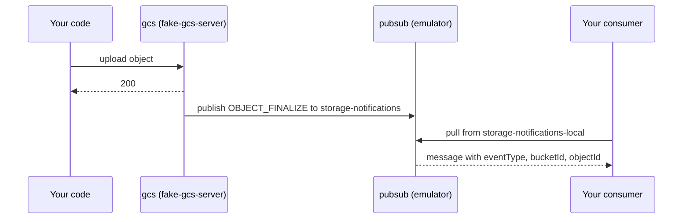

# Receive Cloud Storage notifications locally

After this every object you upload to fake-gcs-server produces a Pub/Sub message on a
subscription your application can pull from, as Cloud Storage notifications do in Google
Cloud.

## When you need this

Your application reacts to new or deleted objects through Cloud Storage notifications: a
bucket publishes an `OBJECT_FINALIZE` message to a Pub/Sub topic and a consumer picks it up.
You want to develop and test that consumer against the local emulators instead of a real
bucket.

## What you need to know first

- **Cloud Storage notifications.** Google Cloud publishes a message to a Pub/Sub topic when an
  object changes. The message carries attributes such as `eventType` and `objectId` and, with
  the `JSON_API_V1` payload format, the object's metadata as JSON in its data. See
  [Pub/Sub notifications for Cloud Storage](https://cloud.google.com/storage/docs/pubsub-notifications).
- **Who publishes locally.** fake-gcs-server publishes the events itself, to the Pub/Sub
  emulator, when it is started with `-event.*` arguments. The emulator fragment
  [`docker-compose.emulators.yaml`](../../docker-compose.emulators.yaml) already passes them,
  for every bucket, to one topic. See
  [Object notifications](../../README.md#object-notifications).
- **Who creates the topic.** Nobody, unless you declare it. fake-gcs-server does not create the
  topic, and the provisioner creates only what the config lists. The provisioner does not
  manage per-bucket notification configurations, which is what you would create in Google
  Cloud instead.

This is the path one upload takes:



The upload's answer does not depend on the publish succeeding, so a missing topic does not
fail the upload (see [Pitfalls](#pitfalls)).

## Steps

The steps assume a Compose project that includes the emulator fragment and runs the
provisioner, as set up in [Add the GCP emulators to your Compose project](add-emulators-to-your-compose-project.md).

### 1. Declare the topic and a subscription

Add the topic to your provisioner config under the name fake-gcs-server publishes to,
`storage-notifications` by default, with a subscription for your consumer. Without a
subscription the emulator accepts every message and keeps none.

```yaml
project_id: local-dev

pubsub:
  topics:
    - name: storage-notifications
      subscriptions:
        - name: storage-notifications-local
          ack_deadline: 30s

storage:
  buckets:
    - name: uploads
```

If your application expects a different topic name, set `STORAGE_NOTIFICATIONS_TOPIC` in
`.env` and declare that name instead. Both must match exactly.

### 2. Choose the events

fake-gcs-server publishes only `finalize` (an upload or an overwrite) by default. To receive
deletions as well, set `STORAGE_NOTIFICATIONS_EVENTS` in `.env` to a comma-separated list:

```dotenv
STORAGE_NOTIFICATIONS_EVENTS=finalize,delete
```

The help text of fake-gcs-server 1.56.1 lists `finalize`, `delete` and `metadataUpdate`. They
arrive as `OBJECT_FINALIZE`, `OBJECT_DELETE` and so on in the `eventType` attribute.

### 3. Keep the project ids aligned

fake-gcs-server publishes to the project in `GCP_PROJECT_ID` as Compose reads it from the
shell or `.env`; the provisioner creates the topic in the `GCP_PROJECT_ID` of its own
`environment:` block. Keep both at the same value, `local-dev` by default.

### 4. Start the stack

```console
$ docker compose up -d
```

The provisioner log must show the topic and the subscription being created:

```json
{"time":"…","level":"INFO","msg":"Creating topic","topic":"storage-notifications"}
{"time":"…","level":"INFO","msg":"Creating subscription","subscription":"storage-notifications-local","topic":"storage-notifications"}
```

## Check that it works

Upload an object from the host through the Cloud Storage JSON API. `<gcs-port>` is
`STORAGE_EMULATOR_PORT` (`4443` by default) and `<pubsub-port>` is `PUBSUB_EMULATOR_PORT`
(`8085` by default). The output below was captured on 2026-11-15 against
`fake-gcs-server:1.56.1` and `google-cloud-cli:593.0.0-emulators`, trimmed:

```console
$ curl -s -X POST --data-binary 'hello' -H 'Content-Type: text/plain' \
    'http://localhost:<gcs-port>/upload/storage/v1/b/uploads/o?uploadType=media&name=hello.txt'
{"kind":"storage#object","name":"hello.txt","id":"uploads/hello.txt","bucket":"uploads","size":"5",…}
```

Then pull from the subscription through the emulator's REST API:

```console
$ curl -s -X POST -H 'Content-Type: application/json' -d '{"maxMessages":10}' \
    http://localhost:<pubsub-port>/v1/projects/local-dev/subscriptions/storage-notifications-local:pull
{
  "receivedMessages": [{
    "ackId": "projects/local-dev/subscriptions/storage-notifications-local:1",
    "message": {
      "data": "eyJraW5kIjoic3RvcmFnZSNvYmplY3QiLCJpZCI6InVwbG9hZHMvaGVsbG8udHh0IzE3OTQ3NjEwOTkzNTAyMTQi…",
      "attributes": {
        "bucketId": "uploads",
        "eventTime": "2026-11-15T16:44:59Z",
        "eventType": "OBJECT_FINALIZE",
        "objectGeneration": "1794761099350214",
        "objectId": "hello.txt",
        "payloadFormat": "JSON_API_V1"
      },
      "messageId": "1",
      "publishTime": "2026-11-15T16:44:59.364Z"
    }
  }]
}
```

The `data` field is base64-encoded object metadata. Decoded, it reads:

```json
{"kind":"storage#object","id":"uploads/hello.txt#1794761099350214","name":"hello.txt","bucket":"uploads","generation":"1794761099350214","contentType":"text/plain","timeCreated":"2026-11-15T16:44:59.350196Z","updated":"2026-11-15T16:44:59.350199Z","storageClass":"STANDARD","size":"5","md5Hash":"XUFAKrxLKna5cZ2REBfFkg==","crc32c":"mnG7TA=="}
```

The `gcs` container log confirms each event it sent:

```console
$ docker compose logs gcs | grep event
gcs-1  | time=… level=INFO msg="sent event OBJECT_FINALIZE for object uploads/hello.txt#…"
```

## Pitfalls

- **A missing topic drops every event, silently.** If the topic does not exist, the upload
  still answers `200` and nothing arrives. The only trace is in the `gcs` log:

  ```console
  $ docker compose logs gcs | grep event
  gcs-1  | time=… level=INFO msg="error publishing event: rpc error: code = NotFound desc = Topic not found"
  ```

  Check, in this order, that the topic is declared in the config, that its name matches
  `STORAGE_NOTIFICATIONS_TOPIC`, and that both `GCP_PROJECT_ID` values agree (step 3). A
  project mismatch produces the same log line.
- **Events published before the subscription existed are gone.** Pub/Sub delivers only to
  subscriptions that existed at publish time. Objects uploaded before the provisioner finished
  produce no message for your consumer, so make the uploading service wait for the
  provisioner with `service_completed_successfully`.
- **A restarted `pubsub` loses the topic.** The emulator keeps nothing in memory across a
  restart, so events are dropped as above until you run the provisioner again with
  `docker compose run --rm gcp-emulator-provisioner`.
- **The REST pull answers `Not Found` without a content type.** Leaving out
  `-H 'Content-Type: application/json'` makes the emulator answer a plain `Not Found`, which
  looks like a missing subscription but is not.
- **All buckets publish to one topic.** The fragment does not filter by bucket. In Google
  Cloud each bucket has its own notification configuration, so filter on the `bucketId`
  attribute in your consumer if it should only see one bucket.
- **Replacing the `gcs` command drops notifications.** If you override `command` for `gcs`,
  for example to keep objects across restarts, the `-event.*` arguments go with it unless you
  repeat them. See [Keep fake-gcs-server objects across restarts](keep-objects-across-restarts.md).

## Further reading

- [Object notifications](../../README.md#object-notifications) in the README.
- [`docker-compose.emulators.yaml`](../../docker-compose.emulators.yaml), whose comments on the
  `gcs` service describe the `-event.*` arguments.
- [Pub/Sub notifications for Cloud Storage](https://cloud.google.com/storage/docs/pubsub-notifications)
  for the message format in Google Cloud.
- [fake-gcs-server](https://github.com/fsouza/fake-gcs-server) upstream.
